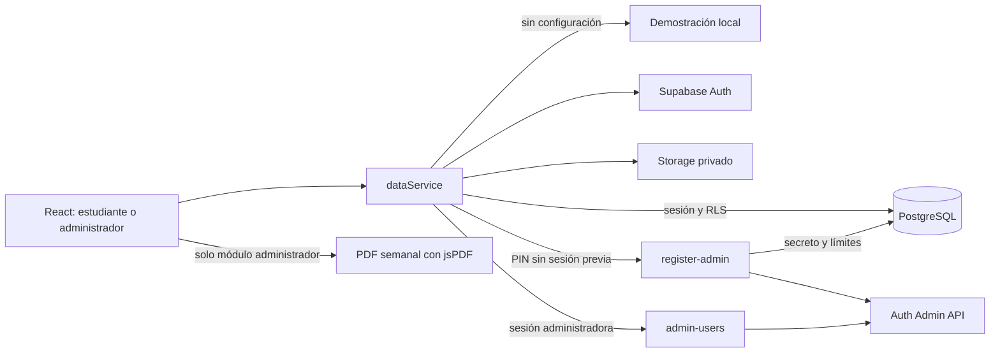

# Manual técnico · CampusFix

Versión simplificada · Revisión del 5 de noviembre de 2026. Este alcance reemplaza el panel operativo extenso anterior.

## 1. Arquitectura



React Router organiza la navegación. TanStack Query conserva y actualiza consultas. React Hook Form y Zod validan los datos de entrada. La capa `dataService` aplica el contrato de permisos y utiliza Supabase cuando están presentes sus dos variables públicas. Una conexión fallida no cambia silenciosamente a una demostración.

## 2. Roles y acciones

| Operación                       | Estudiante (`user`)                 | Administrador (`admin`)         |
| ------------------------------- | ----------------------------------- | ------------------------------- |
| Crear reporte                   | Título, descripción y foto opcional | Sí                              |
| Consultar                       | Solo reportes propios               | Todos los reportes              |
| Cambiar estado                  | No                                  | Pendiente, Urgente, Solucionado |
| Crear o dar de baja estudiantes | No                                  | Sí, mediante función protegida  |
| Obtener consulta y PDF semanal  | No                                  | Sí                              |

La interfaz limita las acciones y las rutas. RLS impone la visibilidad de las filas; los disparadores restringen los campos de creación y rechazan actualizaciones de estudiantes. Las funciones comprueban sesión y rol para las operaciones administrativas. Las contraseñas reales pertenecen a Supabase Auth.

Las rutas vigentes son `/` para la lista activa, `/arreglados` para los solucionados, `/nuevo` para crear, `/reporte/:id` para el detalle y, solo como administrador, `/estudiantes` y `/semanal`. El acceso y la recuperación utilizan `/login` y `/restablecer`. La separación de listas conserva el estado PostgreSQL `Solucionado` y no cambia la privacidad por rol ni la selección semanal.

## 3. Código y contratos principales

| Ruta                                 | Responsabilidad                                                             |
| ------------------------------------ | --------------------------------------------------------------------------- |
| `src/main.tsx`                       | React, QueryClient y Router; HashRouter al abrir `file:`.                   |
| `src/App.tsx`                        | Sesión, rutas y acceso por rol.                                             |
| `src/Shell.tsx`                      | Cabecera, navegación superior, cuenta y controles de demostración.          |
| `src/Incidents.tsx`                  | Invitación a reportar y tarjetas de los registros permitidos.               |
| `src/IncidentEditor.tsx`             | Formulario de título, descripción y fotografía opcional.                    |
| `src/IncidentDetail.tsx`             | Lectura del reporte y cambio de estado exclusivo del administrador.         |
| `src/ReportPhoto.tsx`                | Fotografía privada y estado sin evidencia adjunta.                          |
| `src/Users.tsx`                      | Crear estudiantes y confirmar la retirada del acceso.                       |
| `src/Reports.tsx`                    | Seleccionar semana, consultar sus filas y descargar el documento.           |
| `src/ui.tsx`                         | Delfín vectorial, controles y diálogos compartidos.                         |
| `src/lib/data.ts`                    | Sesiones, reportes, registro administrador, estudiantes y consulta semanal. |
| `src/lib/demo.ts`                    | Datos y credenciales de demostración.                                       |
| `src/lib/validation.ts`              | Validación de formularios y credenciales.                                   |
| `src/lib/pdf.ts`                     | Generación del documento con jsPDF y AutoTable.                             |
| `src/types.ts`                       | Contratos y estados válidos.                                                |
| `public/fonts/`                      | Manrope y Space Grotesk alojadas localmente, con licencias OFL.             |
| `supabase/migrations/`               | Esquema inicial y actualización de noviembre.                               |
| `supabase/functions/register-admin/` | Registro de administrador con PIN y control de intentos.                    |
| `supabase/functions/admin-users/`    | Crear y dar de baja estudiantes como administrador.                         |
| `scripts/export-preview.mjs`         | HTML portátil con bundle, estilos y fuentes.                                |

Contratos vigentes de `dataService`:

| Método                                             | Propósito                                                         |
| -------------------------------------------------- | ----------------------------------------------------------------- |
| `verifyAdminPin(pin)`                              | Verifica el primer paso del registro administrador.               |
| `registerAdmin({pin, full_name, email, password})` | Crea un perfil administrador; no inicia sesión por sí mismo.      |
| `listIncidents()` / `getIncident(id)`              | Devuelven las filas visibles para la sesión.                      |
| `createIncident(input)`                            | Crea el reporte, con valores internos compatibles con el esquema. |
| `updateIncident(id, patch)`                        | Operación restringida al administrador.                           |
| `createUser(input)`                                | Crea únicamente un estudiante de rol `user`.                      |
| `deleteStudent(id)`                                | Da de baja al estudiante conservando reportes.                    |
| `getWeeklyIncidents(lunes)`                        | Consulta administrativa de lunes a domingo.                       |

El código puede conservar tipos o utilidades de compatibilidad de la versión anterior. Su existencia no añade categorías, prioridades, IA o estadísticas a los requisitos ni a las pantallas vigentes.

## 4. Base de datos y actualización

Se aplican [`20261105222213_campusfix.sql`](../supabase/migrations/20261105222213_campusfix.sql) y después [`20261105222523_student_reports.sql`](../supabase/migrations/20261105222523_student_reports.sql). La segunda migración actualiza políticas y estados sin eliminar los reportes previos.

| Entidad                         | Función vigente                                                               |
| ------------------------------- | ----------------------------------------------------------------------------- |
| `profiles`                      | Referencia a `auth.users`, nombre, correo, rol, activación y `deleted_at`.    |
| `incidents`                     | Folio, título, descripción, fotografía, autor, estado y fechas.               |
| `incident_history`              | Conservación de los eventos asociados a los reportes.                         |
| Catálogos iniciales             | Compatibilidad del esquema previo; no son campos del formulario simplificado. |
| Control de intentos de registro | Estado persistente del límite de peticiones a `register-admin`.               |

Los campos técnicos heredados de una creación estudiante reciben valores controlados: categoría `Otros`, edificio `Campus UNACAR`, ubicación `Ver descripción`, prioridad `Media` y estado `Pendiente`. La descripción aporta la ubicación comprensible para quien atiende.

La migración convierte En proceso en Urgente, Resuelta en Solucionado y Cancelada en Pendiente. Conserva fechas y auditoría previa al transformar los datos. Un perfil operativo exige `active = true` y `deleted_at` vacío.

## 5. Registro de administrador mediante PIN

La interfaz presenta primero el PIN y después los datos de cuenta. La verificación remota utiliza:

```ts
supabase.functions.invoke("register-admin", {
  body: { action: "verify", pin: parsed },
});
```

La creación reenvía el PIN junto a nombre, correo y contraseña. El servidor vuelve a comprobar el permiso; completar el primer paso del navegador no concede por sí mismo privilegios.

El valor esperado procede de `ADMIN_SETUP_PIN` en la Edge Function. El flujo solicitado utiliza `1324`. La función tiene `verify_jwt = false` porque permite crear una cuenta antes de iniciar sesión. Usa la API privilegiada de Auth solo después de sus comprobaciones, y no entrega la clave de servicio al navegador.

La validación propia del alta administradora admite 5 caracteres. La UI local permite ese mínimo; conectada exige al menos 6 porque Supabase Auth actual impone ese piso, incluso si su configuración intenta fijar 5. Una política mayor del proyecto también puede rechazar la contraseña. `register-admin` traduce `weak_password` a una respuesta 422 con el requisito real; los estudiantes mantienen 12 en CampusFix. La [guía de configuración](setup-supabase.md#contraseñas-de-administrador-y-estudiante) enlaza las fuentes primarias.

El control de frecuencia se guarda en PostgreSQL y se consume antes de validar los datos: 5 intentos por cliente en 15 minutos y 30 globales por intervalo. Sin el secreto la función queda deshabilitada.

Tanto la verificación como la creación consumen cuota. `register-admin` mantiene la verificación JWT del gateway desactivada; `admin-users` la mantiene activada y además valida el usuario y su perfil en el handler.

**Riesgo del mecanismo:** conocer el PIN permite crear un administrador. El límite de frecuencia no convierte un PIN compartido en verificación institucional de identidad. La rama de demostración compara `1324` en el navegador; solo sirve para recorrer el flujo local.

## 6. Crear y dar de baja estudiantes

`admin-users` requiere un token válido y un perfil administrador activo y no eliminado. La creación produce una cuenta de rol `user`; la interfaz la llama Estudiante. No se usa este módulo para promover alumnos a administradores.

La acción de baja conserva la identidad de Auth para mantener las relaciones, establece `deleted_at`, desactiva el perfil y aplica un bloqueo en Auth. Las filas de reportes e historial no se borran. El perfil inactivo o dado de baja debe quedar rechazado incluso si aún conserva un token anterior.

Las operaciones sobre PostgreSQL y Auth pueden implicar pasos separados. Un error al bloquear Auth debe comunicarse y revisarse; las políticas sobre el perfil inactivo son necesarias para impedir acceso operativo durante esa situación.

El endpoint devuelve `503` y `partial: true` si ya se retiró el perfil pero falló el bloqueo de Auth. Permite volver a intentar la baja del mismo UUID para completar el segundo paso. No elimina físicamente el usuario ni sus relaciones.

## 7. Semanas y PDF

`getWeekRange()` exige una fecha de lunes y devuelve ese día y el domingo siguiente. `getWeeklyIncidents()` comprueba primero el rol:

```ts
await requireSession(true);
return this.listIncidents(getWeekRange(weekStart));
```

Los filtros interpretan la fecha de creación en `America/Mexico_City`. Por ejemplo, la semana del 2 al 8 de noviembre de 2026 comprende lunes 2 desde las 00:00 hasta el final del domingo 8 en esa zona. Los registros del siguiente lunes pertenecen a la semana siguiente.

El PDF se genera en el navegador con `generateIncidentsPdf()`, jsPDF y AutoTable a partir de esa selección administrativa. Incluye identidad, periodo, folio, fecha, título, descripción, persona que reporta, estado y paginación. Los estudiantes no tienen el módulo ni acceso a la consulta semanal de la capa de datos. El documento muestra los estados actuales al generarse, no una reconstrucción del estado histórico al cierre del domingo.

## 8. Fotografías y demostración

Las fotografías reales se almacenan en el bucket privado `incident-photos`, con límite de 5 MB para JPEG, PNG y WebP. Se conserva una ruta de objeto y se solicitan enlaces firmados. Una firma ya emitida puede continuar válida hasta su vencimiento aunque se dé de baja una cuenta; la baja impide nuevas consultas autorizadas.

La demostración conserva las claves locales `campusfix.demo.v1` y `campusfix.demo.session.v1` y migra estados anteriores. Las cuentas creadas localmente utilizan una credencial de demostración con hash y sal; esto no sustituye Supabase Auth ni constituye una protección de producción del navegador. No uses contraseñas reales en la demostración.

## 9. Configuración y entrega

La conexión del frontend necesita `VITE_SUPABASE_URL` y `VITE_SUPABASE_ANON_KEY`. `ADMIN_SETUP_PIN`, `APP_ORIGIN` y las credenciales privilegiadas pertenecen al backend. Sin las variables de conexión, la implementación utiliza `localStorage`; la base compartida preparada es PostgreSQL en Supabase. Consulta [setup-supabase.md](setup-supabase.md) para las migraciones y [github-pages-supabase.md](github-pages-supabase.md) para publicar con GitHub.

`VITE_APP_BASE_PATH` define la ruta pública al compilar y `VITE_USE_HASH_ROUTER=true` activa HashRouter en Pages. El workflow deriva la base de `actions/configure-pages` o acepta una variable de repositorio para sobrescribirla; la app servida con BrowserRouter utiliza `BASE_URL` como `basename`. La recuperación usa la URL base con `?recovery=1` y después navega al formulario, manteniendo el fragmento para React Router.

`pnpm test` ejecuta la suite vigente; `pnpm build` valida TypeScript y crea `dist/`. La exportación `node scripts/export-preview.mjs` produce el HTML portátil después de compilar sin configuración remota. Las fuentes y los estilos quedan incluidos.

Los resultados por fecha y sus límites están en [verificacion.md](verificacion.md). Las pruebas y capturas anteriores no se reutilizan como una aprobación visual de los cambios del 5 de noviembre. El workflow se entrega preparado; no se ejecutó en GitHub ni se creó un repositorio remoto durante esta revisión.
